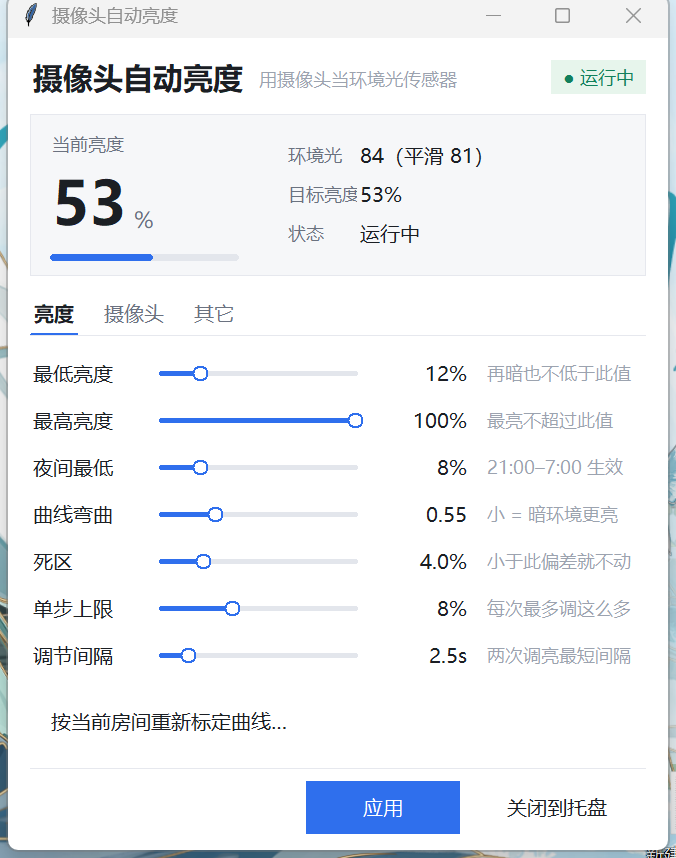
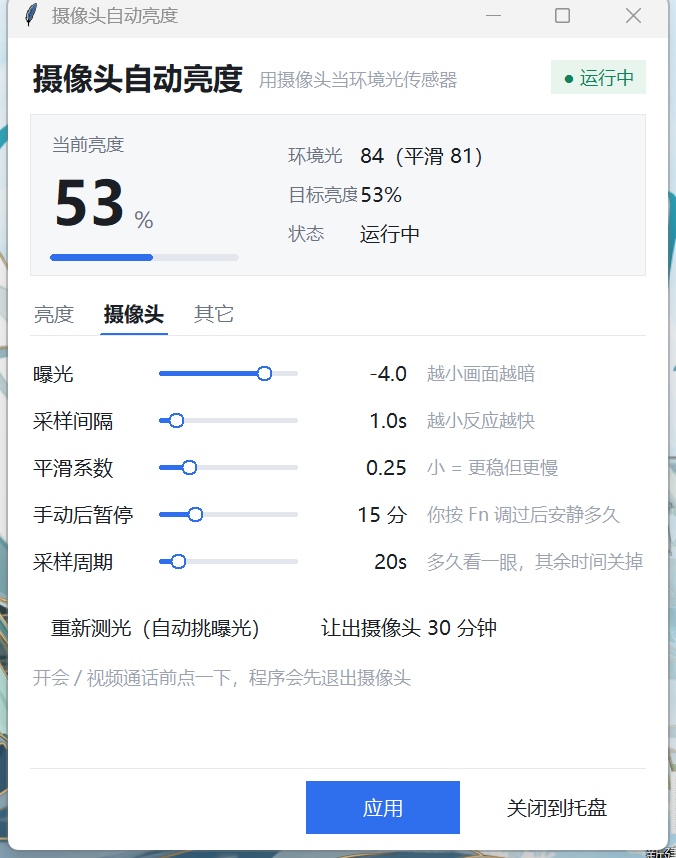
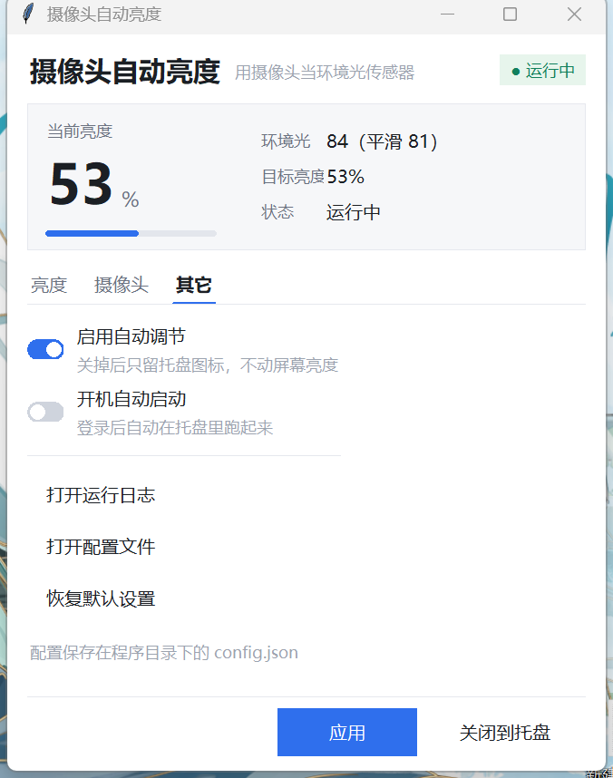

# 摄像头自动亮度 · auto-brightness-webcam


**笔记本没有环境光传感器？那就让摄像头当传感器。**

这个程序用摄像头测房间亮度，自动调节屏幕背光。和"定时按位置切换"的软件不同，
它读的是**真实环境光**；和摄像头自动曝光无关——曝光是锁死的，否则测到的永远是"正常亮度"。

> **EN** — Webcam-based auto-brightness for Windows laptops that have no ambient light sensor.
> Exposure is locked (auto-exposure would cancel out the very thing we measure), the frame center is
> sampled with blown-out pixels dropped, and the panel backlight is driven over WMI (gamma fallback).
> Tray app, no admin rights, no image ever leaves the machine.



## 特性

- **真的测光**：摄像头固定曝光采样，画面过曝像素剔除后取中位数，逐帧归一化
- **不一直开摄像头**：默认每 20 秒看一眼、连采 5 帧就关掉，其余时间设备完全释放（指示灯灭）
- **调的是背光**：优先 WMI（`WmiSetBrightness`），不支持时退到 gamma，任何显示器都能用
- **不会瞎调**：5 点中值 + EMA + 死区 + 单步上限 + 连续确认，有人路过/手挡镜头不会闪
- **不跟你抢**：你按 Fn 调过亮度，它会自动安静 15 分钟
- **托盘常驻 + 图形设置界面**：开机自启一键开关，开会前可"让出摄像头 30 分钟"
- **零额外依赖**：界面用 Tkinter 自绘（圆角滑块、分段页签、开关都是 canvas 画的），不用 Electron
- **本地处理**：画面只在本机算出一个 0–255 的灰度数字，不存图、不上传、不联网

| 亮度 | 摄像头 | 其它 |
| --- | --- | --- |
|  |  |  |

## 安装

需要 Windows 10/11 + Python 3.10 以上（不要用 Microsoft Store 版 Python）。

```powershell
git clone https://github.com/<your-name>/auto-brightness-webcam.git
cd auto-brightness-webcam
python -m venv .venv
.venv\Scripts\python.exe -m pip install -r requirements.txt
```

然后双击 **`启动自动亮度.bat`**（等价于 `.venv\Scripts\pythonw.exe run.py tray`）。
不弹黑框，直接进托盘，窗口会在屏幕中央打开一次。
**第一次运行**会先花几秒自动挑一次曝光并写入 `config.json`，不用手动标定；

命令行用法：

```powershell
.venv\Scripts\python.exe run.py tray          # 托盘常驻（推荐）
.venv\Scripts\python.exe run.py once          # 只测一次、只打印，不改亮度
.venv\Scripts\python.exe run.py calibrate     # 按当前房间重新标定曲线
.venv\Scripts\python.exe run.py test-camera   # 采 10 帧看看画面稳不稳
.venv\Scripts\python.exe run.py autostart on  # 开机自启（写 Startup 快捷方式）
.venv\Scripts\python.exe check.py             # 自检：后端 / 摄像头 / 曝光
```

## 用法

- **托盘图标**：左键或右键出菜单——设置、暂停/继续、重新测光、让出摄像头 30 分钟、打开日志、退出。
- **应用按钮**：滑块改完点「应用」才生效（`config.json` 会立刻写入）。
- **觉得整体偏亮/偏暗**：设置页点「按当前房间重新标定曲线…」，它会重挑曝光并给出新的黑/白点。
- **开视频会议**：托盘菜单「让出摄像头 30 分钟」，这 30 分钟里一次都不会碰摄像头。

## 原理：为什么必须锁死曝光

摄像头默认开自动曝光（AGC）。房间变暗时，AGC 会把画面拉回"正常亮度"——
于是环境光的变化被完全抵消，你测到的永远是一个常数。所以必须：

1. 关掉自动曝光，写死一个曝光值（本项目用 `CAP_PROP_EXPOSURE`，单位 log2 秒）；
2. 采样时只取画面中央区域，剔除接近饱和的像素，再取灰度中位数；
3. 换曝光档位后按 `2^(参考曝光 - 当前曝光)` 把读数折算回同一基准，档位换了也能比较。

另一个坑是**反馈回路**：屏幕的光会照到你脸上，屏幕变亮→脸变亮→读数变亮→想更亮。
死区 + 单步上限 + 最短调节间隔把这条回路压住了，实测不会抖。

## 它是怎么工作的

1. **断续采样**：每 `probe_interval`（默认 20s）开一次摄像头，连采 `burst_samples`（默认 5）帧，
   算出一个读数后立刻 `close()`，设备在空闲期是真释放的。等待时界面显示「运行中 · 7s 后看一眼」。
2. **灰度 → 屏幕亮度**：`(median - black_point) / (white_point - black_point)` 再取 `gamma` 次幂，
   `gamma < 1` 让暗环境不至于太黑；21:00–7:00 允许降到更低的 `night_min_brightness`。
3. **控制环**：5 点中值滤波 → EMA 平滑 → 死区（默认 4%）→ 单步上限（默认 8%），
   而且要连续两次都指向同一方向才动手；**变暗超过 10 个点需要连续 5 次确认**，
   因为灯灭、人挡镜头、摄像头被抢都会造成一两帧的假暗。
4. **全黑帧保护**：中位数 < 1.0 直接丢（摄像头刚打开、合盖、被占用时都可能是黑帧），绝不据此降亮度。
5. **自动换挡**：画面快过曝（中位数 > 215 且过曝像素 > 15%）就减一档曝光，快死黑就加一档
   （上限 -2.5 档，再长会掉帧）；换挡后有 10 秒冷却，且先丢 3 帧——驱动要几帧才真正生效，
   立刻读会拿到旧画面，折算后能把屏幕顶到最亮。
6. **手动覆盖检测**：当前亮度和你上次设置的值差 ≥ 6，判定你按了 Fn，暂停 15 分钟不抢。
7. **自愈**：连续 10 次读不到有效画面，就关掉重开摄像头。

## 配置（config.json）

改完点「应用」，或者直接编辑文件后重启程序。删掉它就会重新生成默认配置。

| 字段 | 含义 | 默认 |
| --- | --- | --- |
| `camera_index` | 摄像头序号（多摄像头时改这个） | 0 |
| `exposure` | 固定曝光值（log2 秒，越负越暗） | -2.5 |
| `exposure_ref` | 归一化基准曝光 | -2.5 |
| `roi` | 采样区域，相对比例 `[x1, y1, x2, y2]` | 见文件 |
| `black_point` / `white_point` | 灰度到亮度曲线的下/上端 | 3 / 320 |
| `gamma` | 曲线弯曲程度，`<1` 更亮 | 0.55 |
| `min_brightness` / `max_brightness` | 亮度上下限 | 12 / 100 |
| `night_min_brightness` | 21:00–7:00 允许的最低亮度 | 8 |
| `sample_interval` | 采样间隔（秒） | 1.0 |
| `burst_samples` | 每轮连采几帧 | 5 |
| `probe_interval` | 两轮之间歇多久（秒） | 20.0 |
| `keep_camera_open` | `true` 则摄像头常开（更实时，但一直被占用） | false |
| `smoothing_alpha` | EMA 系数，越小越稳 | 0.25 |
| `deadband` | 死区（百分点） | 4.0 |
| `max_step` | 单次最大调节幅度 | 8.0 |
| `min_change_interval` | 两次调整最小间隔（秒） | 2.5 |
| `manual_override_minutes` | 手动干预后暂停分钟数 | 15 |
| `paused` | 暂停开关 | false |

## 常见问题

**Q：屏幕亮度完全不动？** 先跑 `python check.py`，看后端是不是 `gamma`。
某些机型 WMI 的 `WmiMonitorBrightnessMethods` 不生效；如果日志里显示 `wmi` 但屏幕没反应，
在 `brightness.py` 里把后端强制成 gamma 试一下（画面会发灰，但能调）。

**Q：亮度被顶到 100% 不动？** 通常是背后有窗/灯，或者曝光被拽得太低。设置页点「重新测光」，
或者把 `exposure` 手动改成 `-2.5`、`exposure_ref` 同样改成 `-2.5`。

**Q：摄像头灯一直亮着？** 检查 `keep_camera_open` 是不是 `true`；也可能是别的程序（微信、Teams、
相机应用）占着设备，此时程序会退避重试，日志出现 `camera-busy`。

**Q：会不会偷偷录我？** 不会。每次采样只保留中央区域灰度中位数这一类统计量，帧数据算完即丢，
程序不写图片、不联网（源码里可以搜，没有任何上传逻辑）。

**Q：合上盖子/锁屏会怎样？** 读不到有效画面，会一直跳过，不调亮度。

## 已知限制

- 只支持 Windows（WMI + WScript + `CAP_DSHOW`）。
- 外接显示器：WMI 只作用于笔记本内置屏，外接屏需要自己接 DDC/CI。
- 白天对着窗户坐，测到的是"脸 + 窗口"的混合光，可能偏亮，把摄像头稍微转向自己即可。
- 摄像头被占用时无法采样，会退避重试，期间不调亮度。
- 没有环境光传感器的机器上，这套方案天生比真传感器慢半拍（默认 20 秒一轮），
  `probe_interval` 调小可以更快，代价是摄像头唤醒更频繁。

## 开发

无框架、无构建步骤，改完直接重启就生效。

```
brightness.py   亮度后端：常驻 PowerShell 通道跑 WMI + gamma 兜底
camera.py       摄像头采样：ROI、过曝剔除、固定曝光、自动换挡
control.py      映射曲线 + 控制环（EMA/死区/步进/手动覆盖/断续采样）
gui.py          设置界面（Tkinter 自绘）
config.py       config.json 读写
run.py          命令行入口、托盘、单实例、开机自启
check.py        自检
test_logic.py   离线测试控制环（不需要摄像头）
test_loop.py    联机跑 N 秒控制环
test_gui.py     渲染三个页签并截图到 _gui-tabs/
tray_probe.py   检查托盘图标是否真的注册进系统
probe_cam.py    压力测试：空闲期摄像头是否真被释放
```

`python test_logic.py` 不需要摄像头就能验证映射单调性、抗扰与调节节奏。

## License

MIT